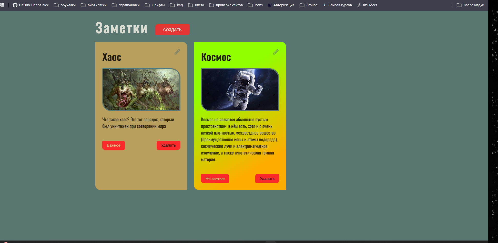
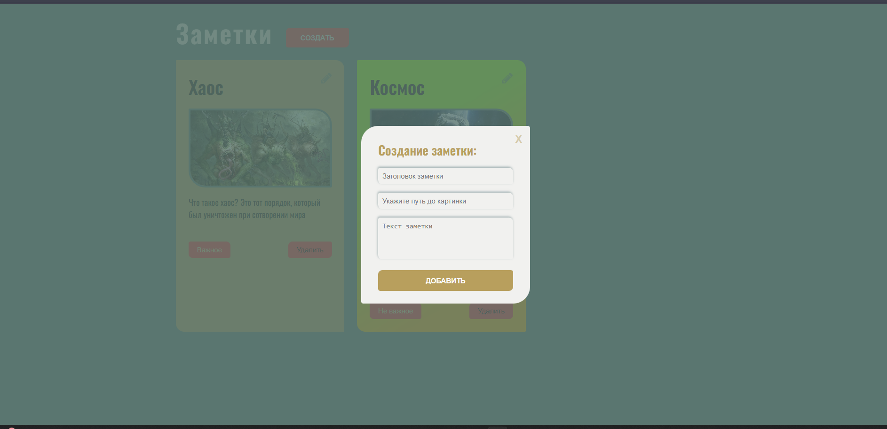

# Notes

Приложение для создания и управления заметками

## О проекте

Notes - веб-приложение для создания и управления заметками. Позволяет сохранять текстовые записи, добавлять изображения и отмечать важные заметки.

Приложение реализовано с использованием нативного JavaScreet без сторонних библиотек и фреймворков.

[Посмотреть демо](https://hanna-alex.github.io/notes/), [Исходный код](https://github.com/Hanna-alex/notes)

## Скриншоты

### Гланая страница



### Создание заметки



## Функциональность

- Создание заметок с заголовком, текстом и изображением.
- Редактирование существующих заметок.
- Удаление заметок.
- Добавление и снятие отметки "Важное".
- Валидация данных формы.
- Использование изображения по умолчанию, если пользователь не указал URL.
- Сохранение заметок в localStorage.
- восстановление данных после перезагрузки страницы.
- Отображение пустого состояния при отсутствии заметок

## Технологии

- HTML5
- JavaScreept (ES6+)
- Sass
- CSS3
- localStorage API

## Особенности реализации

- Динамическое создание элементов интерфайса с помощью DOM API.
- Разделение логики прилодения на функции.
- Обработка событий пользовательского интерфейса.
- Проверка корректности данных при загрузке из localStorage.
- Использование массив и методов работы с ними.
- Работа с формами и валидацией пользовательского ввода

## Запуск проекта

1. Клонировать репозиторий

```
git clone
https://github.com/Hanna-alex/notes
```

2. Перейти в директорию проекта

```
cd notes
```

3. Открыть index.html в браузере или запустить расширение Live Server в VS code
